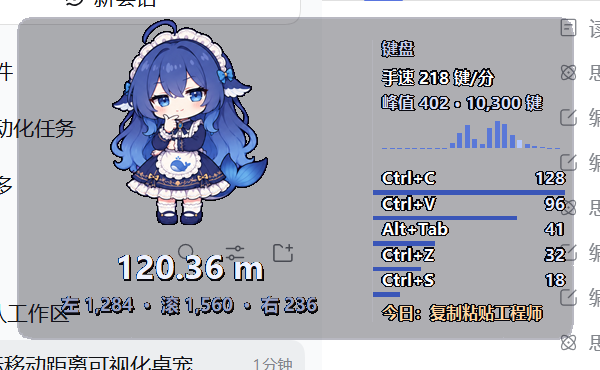
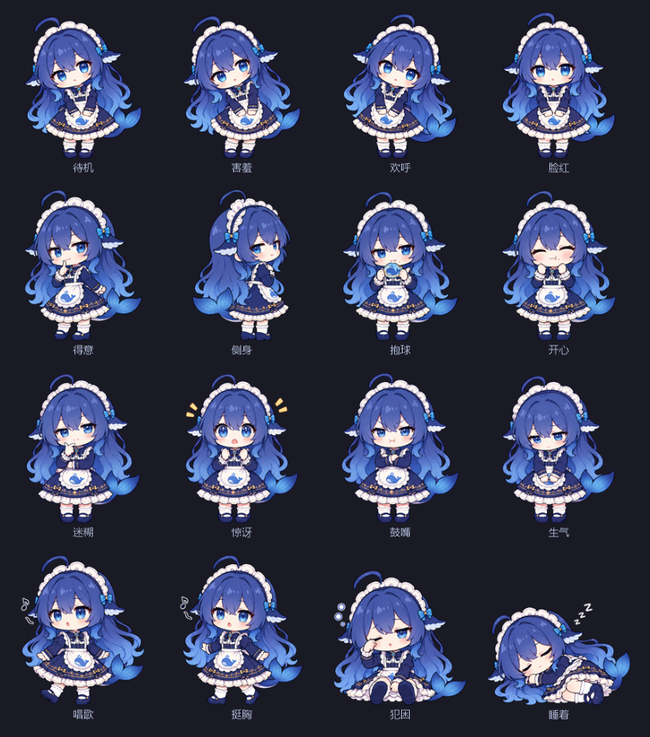
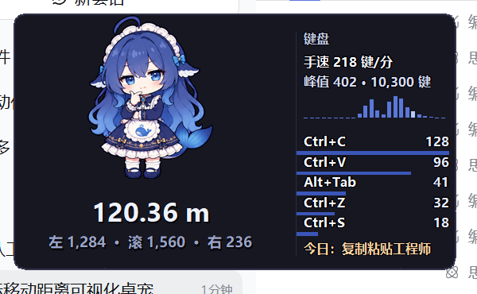
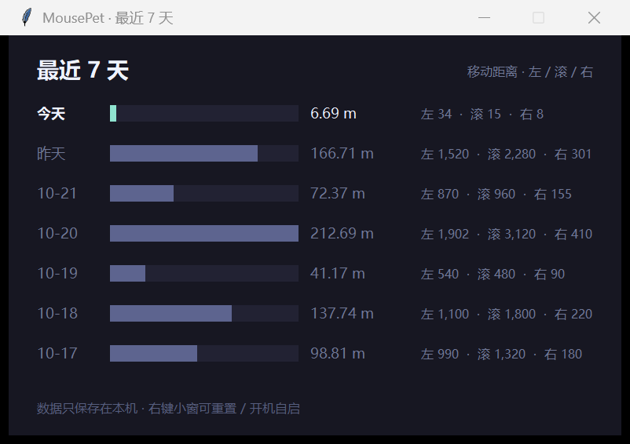

# 鼠标桌宠 MousePet

把「今天鼠标跑了多远、点了多少下、滚了多少格、敲了多少键」做成一只蹲在桌面角落的 **大肥鱼**。

只依赖 Python 标准库（tkinter + ctypes），不需要安装任何第三方包；数据全部存在本地。

## v2.1 更新

- **「表情」菜单按角色过滤**：只显示当前形象真正有的表情。大肥鱼 16 个；ChatGPT / Claude 只有「待机 / 欢呼 / 开心」三个，其余不再列出。
- 切换形象时，如果之前固定的表情在新角色上不存在，会自动回到「自动」。

## v2.0 更新

- **形象菜单整理**：只保留 **大肥鱼（默认）/ ChatGPT Q 版 / Claude Q 版**；小猫、柴犬、企鹅、青蛙已移除。
- ChatGPT / Claude 来自 llm-pet 的 Q 版精灵表，各有待机 / 挥手 / 跳跃三套图；切换形象后窗口尺寸、表情菜单自动跟着换。
- 素材许可：大肥鱼按署名许可；ChatGPT / Claude 要求**署名 + 禁止商用**，本项目保持免费非商业（详见 [THIRD_PARTY_NOTICES.md](THIRD_PARTY_NOTICES.md)）。


## v1.9 更新

- **描边调细**：文字描边从 1.1 降到 0.7，35% 透明度下仍然清楚，但没那么“重”。
- **动作跟数据联动**：不再只有待机 / 开心 / 困，下面这些数据都会触发对应的表情。

| 采集到的数据 | 表情 |
| --- | --- |
| 连续输入（3 秒内 ≥ 6 键） | 唱歌 |
| 手速 ≥ 300 键/分 | 挺胸 |
| 手速 ≥ 420 键/分 | 欢呼 |
| 10 秒内退格 ≥ 10 次 | 鼓嘴 |
| 同一个键 3 秒内连按 ≥ 6 次 | 生气 |
| 3 秒内点击 ≥ 6 次 | 惊讶 |
| 5 秒内滚轮 ≥ 12 次 | 抱球 |
| Ctrl+C / Ctrl+V | 得意 |
| 鼠标在桌宠上停 2 秒 / 6 秒 | 害羞 / 脸红 |
| 拖动 | 侧身 |
| 单击 | 开心 |
| 1 分钟无输入 / 5 分钟 / 15 分钟 | 迷糊 / 犯困 / 睡着 |

> 所有反应都有冷却时间（6–10 秒），不会疯狂闪烁；「表情」菜单里手动固定的表情优先级最高。

## v1.8 更新

- **真眨眼**：待机时每 2.4–6 秒眨一次（0.14 秒），用的是同一姿势的睁眼 / 闭眼两张帧，不再是“盖眼皮”。
- **低透明度也能看清**：右侧文字改成「深色描边 + 加粗 + 提亮」，透明度拉到 35%、叠在亮色网页上也不吃力。



## v1.7 更新

- **16 个表情全接入**：右键 →「表情」，可以选「自动」或手动固定任意一个——待机 / 害羞 / 欢呼 / 脸红 / 得意 / 侧身 / 抱球 / 开心 / 迷糊 / 惊讶 / 鼓嘴 / 生气 / 唱歌 / 挺胸 / 犯困 / 睡着。
- **自动模式**：待机；点一下或拖动后松手 → 开心；5 分钟没有键鼠输入 → 犯困；15 分钟 → 睡着。动一下就醒。
- 手动选的表情会记住，下次启动还是它；选「自动」恢复自动切换。





## v1.5 更新

- **键盘仪表盘**：右侧不再只列字母，改成「手速 / 峰值 / 24 小时节奏 / 组合键 TOP5 / 今日人格」。
- **组合键统计**：Ctrl+C、Ctrl+V、Alt+Tab、Ctrl+Z 这类组合，比字母频率有意思得多。
- **24 小时节奏条**：每根柱子是一小时内的按键量，当前小时高亮。
- **今日键盘人格**：按复制粘贴量、退格率、撤销次数、夜间占比等算一个标签。


## v1.3 更新

- **透明度只作用在卡片背景**：角色和数字放在独立的一层，永远保持不透明；调整透明度时只有背后的圆角卡片变淡。
- **统计顺序改成 左 → 滚轮 → 右**，一行显示；字重和移动距离一样加粗，浅色背景下更清楚。
- 大肥鱼仍是参考图抠出的透明 PNG；手绘形象（猫 / 柴犬 / 企鹅 / 青蛙）保留。


## 功能

- **今日移动距离**：全局低级鼠标钩子（WH_MOUSE_LL）逐点累计，按屏幕 DPI 换算成 cm / m。
- **左键 / 右键 / 滚轮**：实时计数，千分位显示。
- **键盘仪表盘**：全局低级键盘钩子（WH_KEYBOARD_LL）统计手速、组合键和节奏，右侧显示今日概览。
- **会动**：真眨眼 + 16 个表情，按手速、退格、连点、滚轮、复制粘贴等数据自动切换，也可以在右键「表情」里手动固定。
- **按天记录**：过零点自动归档，右键「最近 7 天」看柱状对比。
- **迷你形态**：单击小窗切换，只剩角色和距离。
- **可拖动、可置顶、可开机自启**，位置和设置都会记住；形象可切换（大肥鱼 / ChatGPT / Claude）。



## 运行

需要 Windows + Python 3.9 以上（自带 tkinter）。

```bat
pythonw mouse_pet.py
```

或者直接双击目录里的 **`启动鼠标桌宠.vbs`**（无黑框）。

也可以 `python mouse_pet.py`，程序会立刻把自身转成 pythonw 后台进程后退出，不会留下控制台。

> 想保留控制台看输出（调试用）：
> `set MOUSEPET_NO_CONSOLE_RELAUNCH=1` 后再运行 `python mouse_pet.py`。

## 换一台电脑能用吗

可以，需要满足：

- **Windows**（程序用了 Win32 低级钩子和 Tk 的 `-transparentcolor`，macOS / Linux 不行）。
- **Python 3.9 或更高**，安装时勾选 “Add python.exe to PATH”。tkinter 随 Python 自带，**不需要 pip 安装任何依赖**。
- 把整个 `mouse-pet` 文件夹拷过去，**先删掉 `data/` 目录**：里面是这台机器的窗口位置、透明度、统计记录和计划任务 XML，不该跟着走。

启动脚本会自动找 Python：本机 pythonw → `pyw.exe` 启动器 → PATH 里的 `pythonw.exe`，找不到会弹提示。

会自动适应的：屏幕分辨率和 150% / 200% 缩放（窗口与字体按 DPI 缩放）、多显示器（位置越界会拉回可见区域）、不同的 `%APPDATA%` 路径（数据目录不可写时自动回退）。

不行的：

- 目标电脑没装 Python：得先装，或者用 PyInstaller 打包成 exe（本版本没有内置打包）。
- 想统计管理员窗口里的操作：目标机也要让桌宠以管理员运行（UIPI，见上面的说明）。

`assets/` 里的大肥鱼贴图来自社区项目的署名许可素材（见下方「素材说明」），可以随项目一起分发，保留 `THIRD_PARTY_NOTICES.md` 即可。

## 打包成 exe（可选）

不想让目标电脑装 Python，可以用 PyInstaller 打包。目录里已经放了 `build_exe.bat`，双击即可（首次会自动装 PyInstaller，需要网络）。

手动命令等价于：

```bat
pip install pyinstaller
pyinstaller --onedir --windowed --name MousePet --add-data "assets;assets" mouse_pet.py
```

打包结果是**一个文件夹**：

```
dist\MousePet\
├─ MousePet.exe
├─ _internal\          ← 运行时和贴图都在这里，必须跟 exe 一起发
└─ data\               ← 首次运行自动生成
```

分发时把整个 `dist\MousePet` 文件夹压缩发过去，对方解压后双击里面的 `MousePet.exe`。**不要只发 exe**，`_internal` 必须一起。

- 选择 `--onedir` 而不是 `--onefile`：单文件 exe 每次启动都要解压到 `%TEMP%`，在部分环境（沙箱、权限受限）会报 “could not create temporary directory”；文件夹版不需要临时目录，启动也更快。
- 首次运行会有 SmartScreen 提示（exe 未签名）：点「更多信息」→「仍要运行」。
- 想换贴图又不想重新打包：把 `assets\` 文件夹放到 exe 旁边即可，程序优先用外面的。
- **改代码（`.py`）必须重新打包**；改配置、换贴图、看统计数据这些不用。

> 打包脚本依赖 PyInstaller（首次运行会 `pip install`，需要网络）。个别杀毒软件可能会对 PyInstaller 打的 exe 误报，加白名单即可。

## 交互

| 操作 | 效果 |
| --- | --- |
| 按住拖动 | 移动小窗 |
| 单击 | 切换 完整 / 迷你 形态 |
| 右键 | 菜单：形象、背景透明度、总在最前、迷你、最近 7 天、重置、开机自启、打开数据文件夹、以管理员身份重启、退出 |

## 形象

右键 → **形象**：

| 形象 | 说明 |
| --- | --- |
| 大肥鱼（默认） | 蓝发女仆鲸鱼娘，Q 版表情差分 |
| ChatGPT Q 版 | 白发龙角少女，待机 / 挥手 / 跳跃 |
| Claude Q 版 | 橙发读书少女，待机 / 挥手 / 跳跃 |

贴图放在 `assets/` 下，按不同 DPI 预渲染了多个尺寸，程序启动时挑最接近的一张：

- 大肥鱼：`dfy_<高度>.png` + `dfy_<高度>_<表情>.png`
- ChatGPT：`gpt_<高度>.png` + `_happy` / `_cheer`
- Claude：`claude_<高度>.png` + `_happy` / `_cheer`

想换角色，把自己的透明 PNG 按这些尺寸替换即可。

> 切换形象时窗口高度会跟着变，这是正常的。

## 透明度

右键 → **背景透明度**：

- 预设：100% / 92% / 86% / 75% / 60%
- **自定义…**：弹出滑块面板，35%–100% 实时生效，松手保存。

只有卡片背景会变透，**角色和数字始终不透明**（程序里是两层窗口：底层画卡片并应用透明度，上层画角色和数字）。所以即使把背景调到很透，数字依然清楚。

配置文件里对应 `"opacity": 0.86`（0.35–1.0）。

## 键盘仪表盘

主界面右侧从上到下：

- **手速**：最近 60 秒的按键数（键/分）；**峰值**是今天出现过的最高手速；
- **24 小时节奏条**：每根柱子是一个小时内的按键量，当前小时会高亮；
- **组合键 TOP5**：Ctrl+C、Ctrl+V、Alt+Tab、Ctrl+Z 这类，带比例条；
- **今日人格**：按复制粘贴量、退格率、撤销次数、夜间占比、峰值手速算出来的标签，例如「复制粘贴工程师」「退格狂魔」「撤销依赖症」「深夜键盘侠」「键盘机关枪」「键盘马拉松」「稳重型选手」。

> 只记录组合键和计数，不记录输入内容，也不记录输入顺序。

## 数据

数据在脚本旁边的 `data/` 目录（若不可写，会退回到 `%APPDATA%\MousePet\`）：

| 文件 | 内容 |
| --- | --- |
| `stats.json` | 按日期保存：`px`、`left`、`right`、`wheel`、`keys`、`combos`（组合键）、`hours`（24 小时按键分布）、`kpm_peak`、`typing_seconds` |
| `config.json` | 窗口位置、形象、透明度、是否置顶、是否迷你 |
| `mousepet.log` | 运行日志，排查问题用 |

- 每 5 秒落盘一次，正常退出再存一次；重启时会接上当天的数据继续累计。
- 只保留最近 120 天。
- 键盘只记录「每个键按了多少次」，**不记录输入顺序、也不记录输入内容**。
- 不上传、不联网，删掉 `data/` 就清空所有记录。

## 距离和滚轮怎么算

- **移动距离**：钩子拿到的是屏幕物理像素，相邻采样点直线距离累加。默认按系统 DPI 换算 `px_per_cm = DPI / 2.54`（96 DPI ≈ 37.8 px/cm，150% 缩放 ≈ 56.7 px/cm）。觉得不准可以在 `config.json` 里写 `"px_per_cm": 50.0` 校准。
- **滚轮**：每格 120 单位，显示的是「格数」。向上、向下滚都按绝对值累计，所以是「滚过的距离」而不是净滚动量。

## 开机自启

右键 → **开机自启**，会在

```
%APPDATA%\Microsoft\Windows\Start Menu\Programs\Startup\MousePet.vbs
```

生成启动脚本。取消勾选或删掉该文件即可关闭。这种方式是**普通权限**启动。

右键 → **开机自启（管理员）** 则会创建一个计划任务 `MousePet`（登录时触发、最高权限），这样登录后桌宠直接是管理员权限，不会弹 UAC，也能统计管理员窗口里的鼠标。

- 这项设置本身需要管理员权限：菜单会提示并以管理员身份重启一次（一次 UAC）。
- 开启后会自动删掉上面那个启动文件夹的旧自启，避免双开。
- 如果程序运行在受限环境里（任务计划程序被拦截），可以双击文件夹里的 **`设置开机自启_管理员.vbs`**，在 UAC 弹窗里点「是」。
- 取消：再次点击该菜单项，或在「任务计划程序」里删除 `MousePet` 任务。

## 文件结构

```
mouse-pet/
├─ mouse_pet.py              主程序（单文件，标准库）
├─ 启动鼠标桌宠.vbs           双击启动，无控制台
├─ 设置开机自启_管理员.vbs     一键创建管理员自启的计划任务
├─ build_exe.bat             打包成 exe（可选）
├─ assets/                   三个形象的多尺寸贴图
├─ README.md
├─ demo.png
├─ demo_history.png
├─ demo_alpha.png
├─ demo_characters.png
├─ demo_expressions.png
└─ data/                运行后自动生成
```

## 素材说明

- **大肥鱼**：来自 [YunYueSama/codex-deepseek-pet](https://github.com/YunYueSama/codex-deepseek-pet) 的表情总表，使用「大肥鱼项目署名许可 1.0」（免费使用/修改/分发，需署名并保留许可）。
- **ChatGPT / Claude Q 版**：来自 [savanna0425/llm-pet](https://github.com/savanna0425/llm-pet)，形象作者 **ZipZipPipe**；按作者要求**必须署名、禁止商用**。本项目保持免费、非商业使用。

完整署名、第三方许可全文和修改说明见 [THIRD_PARTY_NOTICES.md](THIRD_PARTY_NOTICES.md)。

这些形象都是社区二创，并非各家公司的官方素材；相关名称与商标归其所有者。如权利人提出异议会移除。

想换角色的话，把 `assets/` 里对应前缀的 PNG 换成自己的透明图即可；删掉大肥鱼的图会让程序退回手绘的蓝色胖鲸兜底。

## 常见问题

**还有黑框？**
看看 `pythonw.exe` 是否存在（和 `python.exe` 同目录）。如果 Python 安装时没带 pythonw，就只能用控制台。

**为什么在管理员程序的窗口里操作时数字不涨？**
Windows 的 UIPI 安全限制：普通权限进程的低级钩子**看不到发给管理员窗口的输入**（鼠标和键盘都是）。所以点桌宠自己（普通权限）能统计，点以管理员运行的程序（例如本机的 DeepSeek Harness）就统计不到。

解决：右键 → **以管理员身份重启…**，通过 UAC 后桌宠以管理员运行，就能看到管理员窗口里的鼠标了（重启后程序本身也是管理员权限）。普通窗口不受影响。

> 开机自启默认是非管理员启动；如果需要在管理员窗口里也统计，需要手动用菜单重启一次（或把启动项改成计划任务的高权限方式）。

**玩原神 / 其他游戏时数字不涨？**
多数游戏（尤其带反作弊的）会以管理员权限运行，或由反作弊驱动把进程提到高完整性级别。普通权限的桌宠同样被 UIPI 挡住，看不到发给游戏窗口的输入，表现就是「一进游戏就不记录了」。

可以按顺序排查：

1. 退出游戏后看数字有没有补涨——没有补涨才是真的没记录（全屏时桌宠被游戏盖住，看起来像停了）；
2. 把游戏切到「窗口化」或「无边框窗口」再试；
3. 右键桌宠 →「以管理员身份重启…」后再进游戏，这是最可能解决的办法；
4. 以管理员运行后仍然不涨，基本就是游戏反作弊拦截了全局钩子，软件层面没有可靠绕过的办法。

**数字一直是 0 / 不动了？**
看 `data/mousepet.log` 有没有 `mouse hook installed`。安全软件拦截全局钩子很常见，把 Python 加入白名单试试。

**窗口找不到了？**
删掉 `data/config.json` 再启动，会回到右下角默认位置。

**大肥鱼变成一只蓝色胖鲸了？**
说明 `assets/` 里的贴图没找到，程序自动退回了兜底形象。检查 `assets/dfy_*.png` 是否还在。

**全屏游戏挡画面？**
右键取消「总在最前」，或切迷你模式。

**多显示器 / 改过缩放？**
距离按虚拟桌面坐标累计，跨屏连续；不同 DPI 的屏混用时数字会有偏差，可用 `px_per_cm` 校准。

## 已知限制

- 仅支持 Windows（Win32 钩子 + Tk 的 `-transparentcolor`）。
- 半透明是整窗透明度，不是逐像素模糊，所以没有真正的「毛玻璃模糊」。
- 贴图版形象以静态帧为主，靠待机/表情切换表现状态，没有逐帧动画。
- 极少数安全软件会拦截全局低级鼠标钩子；被拦截时窗口正常显示，但数字不会涨。
